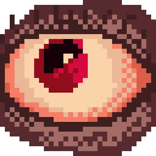
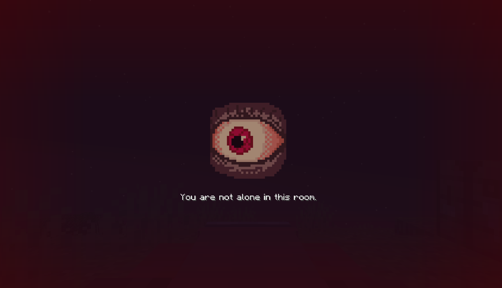
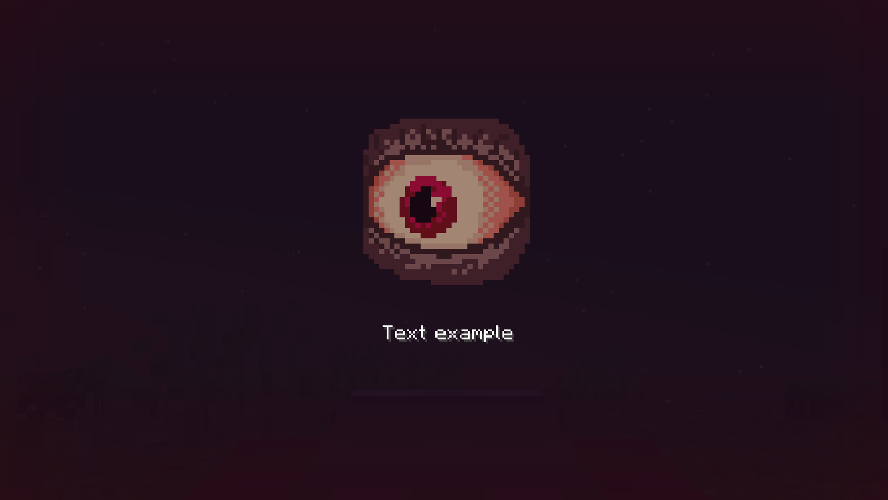

import Tabs from '@theme/Tabs';
import TabItem from '@theme/TabItem';
import Admonition from '@theme/Admonition';


<div style={{textAlign: 'center'}}>
    
</div>

<Admonition type="info">
    This page covers version **1.1** of the mod.
</Admonition>

Midnight Nightmares is a horror version of the Midnight Thoughts mod. It introduces a spooky overlay during sleep that fits perfectly into any horror modpack.

Midnight Nightmares is a separate mod with its own config. Everything else on this wiki is about Midnight Thoughts.

The mod must be installed on both the client and the server, in the same version.

---

## The overlay

When a player goes to bed, the screen is covered by a pulsing blood red overlay. A watching eye appears in the middle, and below it random nightmares fade in and out one after another.



While the overlay is up, the crosshair is hidden, and so is the chat unless you turn that off. The overlay disappears as soon as the player gets out of bed.

---

## Config

The config file is `config/mnightmares/mnightmares.json`. It is created on the first launch.

Every setting can also be changed in game: open the mods list, select **Midnight Nightmares** and press **Config**. The screen has two sections, **Sleep overlay** and **Server behaviour**. Changes are saved when you leave a section.

```json
{
  "sleepOverlay": {
    "minSlideDisplayTimeMs": 2500,
    "maxSlideDisplayTimeMs": 4000,
    "fadeInDurationMs": 300,
    "fadeOutDurationMs": 300,
    "overlayOpacity": 0.4,
    "textOpacity": 1.0,
    "imageOpacity": 0.6,
    "enableImage": true,
    "userContentReplaces": false,
    "hideChatWhenSleeping": true,
    "eyeAnimationSpeedMs": 100,
    "hideHudMessagesWhenSleeping": false,
    "textScale": 1.0,
    "imageScale": 1.0
  },
  "server": {
    "resetPhantomTimerForNonSleepers": true,
    "suppressVanillaSleepMessages": false
  }
}
```

### Sleep overlay

| Parameter | Default | Description |
|---|---|---|
| `minSlideDisplayTimeMs` | `2500` | The shortest time a single nightmare stays on screen, in milliseconds |
| `maxSlideDisplayTimeMs` | `4000` | The longest time a single nightmare stays on screen. Each nightmare picks a random time between the two |
| `fadeInDurationMs` | `300` | How long a new nightmare takes to appear |
| `fadeOutDurationMs` | `300` | How long the previous nightmare takes to disappear |
| `overlayOpacity` | `0.4` | How strongly the pulsing red overlay covers the world, from `0.0` to `1.0` |
| `textOpacity` | `1.0` | How solid the nightmare text looks, from `0.0` to `1.0` |
| `imageOpacity` | `0.6` | How solid the eye looks, from `0.0` to `1.0` |
| `enableImage` | `true` | Shows the watching eye above the text. Set to `false` to show only the text |
| `userContentReplaces` | `false` | Whether your own nightmares replace the built-in ones, see [custom nightmares](#custom-nightmares) |
| `hideChatWhenSleeping` | `true` | Hides the chat window while the overlay is up |
| `eyeAnimationSpeedMs` | `100` | How long each frame of the eye animation stays on screen. Lower values make the eye move faster |
| `hideHudMessagesWhenSleeping` | `false` | Hides action bar messages while the overlay is up |
| `textScale` | `1.0` | Scales the nightmare text, from `0.5` to `1.5`. Longer texts wrap onto more lines |
| `imageScale` | `1.0` | Scales the eye, from `0.5` to `1.5`. The text below moves with it |

<Admonition type="note">
    `textScale` and `imageScale` outside the `0.5` to `1.5` range are clamped back into it, and the correction is written to the log.
</Admonition>

### Server behaviour

| Parameter | Default | Description |
|---|---|---|
| `resetPhantomTimerForNonSleepers` | `true` | When the night is skipped, players who stayed awake also stop attracting phantoms. Set to `false` to reset the timer only for players who actually slept |
| `suppressVanillaSleepMessages` | `false` | Hides the vanilla "players sleeping" and "skipping night" messages |

---

## On a server

When a player joins, the server sends its own config, and that copy is used for the whole session. Every player sees the same overlay, whatever is in their local file.

<Admonition type="note">
    While connected to a server, the in-game config screen shows only a note that the settings come from the server's config file. Server owners change settings in `config/mnightmares/mnightmares.json` on the server.
</Admonition>

Changes take effect without a restart:

```
/midnightnightmares reload
```

The command reloads the config and the custom nightmares and sends them to everyone online. It requires operator permission level 2.

---

## Custom nightmares

On the first launch the mod creates a folder for every supported language:

```
config/mnightmares/nightmares/en_us/nightmares.json
config/mnightmares/nightmares/ru_ru/nightmares.json
...
```

Add your own nightmares to these files. By default they are **mixed in** with the built-in ones. With `userContentReplaces` set to `true`, only your own nightmares are shown.

<Admonition type="tip">
    You only need to fill in the languages you care about. If replacement is on but a language file is empty, players with that language simply see the built-in nightmares.
</Admonition>

<Tabs>
    <TabItem value="single" label="One entry" default>

        ```json
        {
          "entries": [
            { "text": "Text example" }
          ]
        }
        ```

    </TabItem>
    <TabItem value="multiple" label="Several entries">

        ```json
        {
          "entries": [
            { "text": "First nightmare" },
            { "text": "Second nightmare" },
            { "text": "Third nightmare" }
          ]
        }
        ```

    </TabItem>
</Tabs>

<Admonition type="warning" title="Commas between entries">
    Every entry except the last one must end with a comma. Without it the file is not valid JSON and is skipped completely. The last entry must **not** have a comma after it.
</Admonition>

An entry with a missing or empty `text` is skipped.



On a server the custom nightmares are taken from the server's folder and sent to every player, so players do not need their own files.

---

## Languages

The menu and the built-in nightmares are translated into 13 languages:

| Code | Language |
|---|---|
| `en_us` | English |
| `de_de` | German |
| `es_es` | Spanish |
| `fr_fr` | French |
| `it_it` | Italian |
| `ja_jp` | Japanese |
| `ko_kr` | Korean |
| `pl_pl` | Polish |
| `pt_br` | Brazilian Portuguese |
| `ru_ru` | Russian |
| `tr_tr` | Turkish |
| `uk_ua` | Ukrainian |
| `zh_cn` | Simplified Chinese |

Nightmares follow the game language. If the game language is not on the list, English is used.
