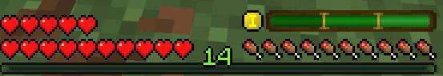

import Tabs from '@theme/Tabs';
import TabItem from '@theme/TabItem';
import Admonition from '@theme/Admonition';

# Player statistics

The mod collects the following player statistics:

| Statistic | Description |
|---|---|
| Blocks broken | Number of broken blocks |
| Distance traveled | Number of blocks passed, regardless of movement method |
| Deaths | Number of deaths |
| Jumps | Number of jumps |
| Mobs killed | Number of mobs killed |
| Damage dealt | Amount of damage dealt |

After players sleep, they will see a summary of the accumulated data since their last sleep. On the summary card the statistics are shown either in the tooltip of the stats panel or as a table right on it, depending on the [summary style](./summary-screen#summary-style). In addition to statistics, achievements are also displayed. The default achievements are stat records: distance record, block mining record, and mob kill record.

Custom achievements are also displayed, more information is available in the [custom achievements](./custom-achievements) tab.

<Admonition type="note">
    Statistics are counted **since your last sleep**, not since the world began, and each player has their own counter. If someone else sleeps while you are awake, your numbers keep running.
</Admonition>

Records - best distance, most blocks, most mobs - and unlocked achievements persist across sessions. They are stored per world and saved atomically, so a crash cannot corrupt them.

---

## MVP

Multiplayer features an MVP: the player with the most points since their last sleep. If other players slept while a player was awake, their stats are not reset. The counter is unique to each player.

<Tabs>
    <TabItem value="points" label="Points" default>

        | Parameter | Value | Description |
        |---|---|---|
        | `pointsPerDistance100` | 2 | Points per 100 blocks traveled |
        | `pointsPerBlock` | 3 | Points per block broken |
        | `pointsPerMob` | 15 | Points per mob killed |
        | `pointsPerJump10` | 1 | Points per 10 jumps |
        | `penaltyPerDeath` | 30 | Points deducted per death |

    </TabItem>
    <TabItem value="config" label="Config">

        ```json
        "mvp": {
        "enabled": true,
        "minScoreRequired": 10,
        "pointsPerDistance100": 2,
        "pointsPerBlock": 3,
        "pointsPerMob": 15,
        "pointsPerJump10": 1,
        "penaltyPerDeath": 30,
        "mvpWellRestedDurationMinutes": 21
    }
        ```

    </TabItem>
</Tabs>

<Admonition type="info">
    `minScoreRequired: 10` - the minimum number of points required to be an MVP. If no player reaches this threshold, there will be no MVP that night.
</Admonition>

The MVP receives a separate buff, with the same attributes and effects as Well Rested level 5, but with a different duration (`mvpWellRestedDurationMinutes: 21`). By default this is longer than the standard level 5 duration. The MVP always gets this buff, no matter how comfortable their bed was.

On the summary screen the MVP card comes first and has its own frame.



All parameters listed above are configurable, in the config file or in the **MVP scoring** section of the config screen.

<Admonition type="tip">
    MVP functionality can be completely disabled by setting `"enabled": false` in the config.
</Admonition>

---

## Experience for the day

After sleeping, every player gets experience for what they did since their last sleep. It uses the same points as the [MVP score](#mvp): the points are multiplied by `experiencePerPoint` and the fraction is dropped.

The experience is given together with the summary. Only players who slept through the night get it, each one exactly their own amount.

| During the day | Points | Experience |
|---|---|---|
| 2000 blocks traveled | 40 | 1 |
| 20 mobs killed | 300 | 9 |
| 500 blocks broken | 1500 | 45 |
| 2000 blocks broken | 6000 | 180 |

<Tabs>
    <TabItem value="parameters" label="Parameters" default>

        | Parameter | Default | Description |
        |---|---|---|
        | `enabled` | `true` | Turns experience for the day on or off |
        | `experiencePerPoint` | `0.03` | How much experience one point is worth |
        | `maxExperiencePerSleep` | `0` | The most experience a player can get from one sleep. `0` means no limit |

    </TabItem>
    <TabItem value="config" label="Config">

        ```json
        "experience": {
          "enabled": true,
          "experiencePerPoint": 0.03,
          "maxExperiencePerSleep": 0
        }
        ```

    </TabItem>
</Tabs>

A few rules worth knowing:

- Experience does not depend on the MVP. It is given even with the MVP turned off, and in single player.
- Changing the MVP point values also changes the experience, since both use the same points.
- A day with more death penalty than points gives nothing, but never takes away experience the player already has.
- A player who got out of bed before morning gets no experience, the same as with the summary.

<Admonition type="tip" title="For modpacks with mob farms or big mining tools">
    Mob farms and tools that break many blocks at once can earn a lot of points in one day. If that gives too much experience, set `maxExperiencePerSleep`, for example to `100`, instead of lowering the rate for everyone.
</Admonition>

How much experience a player got is shown on the [summary card](./summary-screen#rewards), when you hover over their head.

All three parameters are in the **MVP scoring** section of the config screen. The limit slider goes up to 1000, the file accepts up to 1000000.