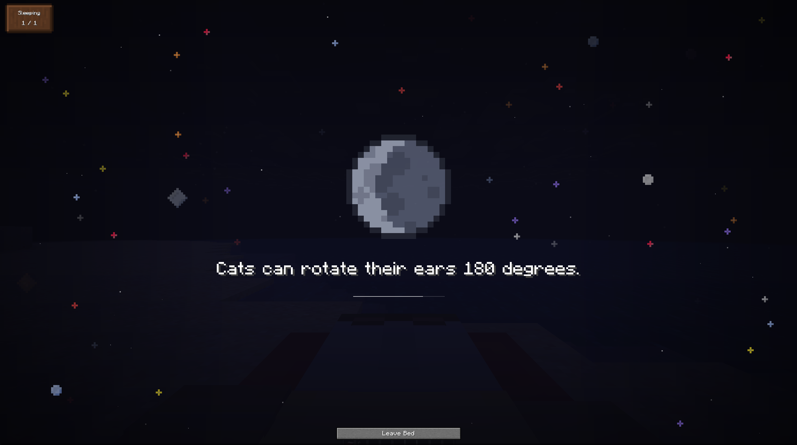
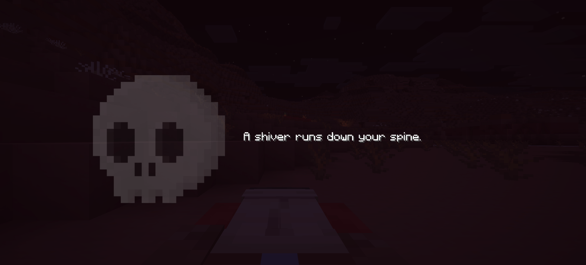
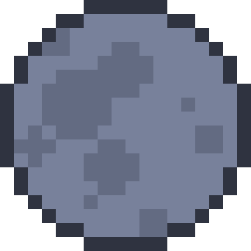

import Tabs from '@theme/Tabs';
import TabItem from '@theme/TabItem';
import Admonition from '@theme/Admonition';

# Sleep overlay

When the player goes to bed, they see an overlay.



The overlay includes an image of the moon and random facts, or an image of a skull and corresponding nightmares.



The moon displays the current phase of the Minecraft world.

<div style={{textAlign: 'center'}}>
    
</div>

A nightmare happens when the comfort around the bed drops to `nightmareThreshold` (**-1** by default) or lower. Drop further, to `sleepBlockThreshold` (**-2** by default), and the player cannot go to bed at all. Both numbers are configurable, see the [comfort system](./comfort-system) page.

---

## Background

On a normal night the text sits on top of two layers:

- **Stardust**: small drifting specks of light. They keep clear of the moon and the text, so nothing sparkles over what you are reading
- **Space objects**: distant planets and stars that slowly fade in and out behind the text. Larger ones are rarer and fade more slowly than small ones

Instead of the calm sky of a normal night, a nightmare replaces the background with a dark red vignette that slowly closes in and opens back up, like laboured breathing. It is not a flashing effect, the movement is deliberately slow.

<Admonition type="note">
    `enableStarDust` controls both the stardust on a normal night and the red vignette during a nightmare. `enableSpaceObjects` only affects normal nights, nightmares never show space objects.
</Admonition>

The overlay is fully customizable, from the config screen (**Sleep overlay** section) or from the config file.

---

## Config

<Tabs>
    <TabItem value="timing" label="Timing" default>

        | Parameter | Default | Description |
        |---|---|---|
        | `minSlideDisplayTimeMs` | 6000 | Minimum slide duration in milliseconds |
        | `maxSlideDisplayTimeMs` | 8000 | Maximum slide duration in milliseconds |
        | `fadeInDurationMs` | 300 | How quickly a new slide appears |
        | `fadeOutDurationMs` | 300 | How quickly a slide disappears |

        The final slide time is randomly chosen between `minSlideDisplayTimeMs` and `maxSlideDisplayTimeMs`, allowing more vibrant slides with varying durations.

    </TabItem>
    <TabItem value="appearance" label="Appearance">

        | Parameter | Default | Description |
        |---|---|---|
        | `overlayOpacity` | 0.4 | How strongly the world behind the overlay is dimmed (excludes text and images) |
        | `textOpacity` | 1.0 | Transparency of text, where 1 = 100% |
        | `imageOpacity` | 0.6 | Transparency of images, where 1 = 100% |
        | `textScale` | 1.0 | Size of the slide text, from 0.5 to 1.5. Long texts are still shrunk to fit the screen |
        | `imageScale` | 1.0 | Size of the moon or the skull, from 0.5 to 1.5. The text below moves with it |
        | `specialSlideChance` | 0.05 | Chance of a rare slide appearing instead of an ordinary one |
        | `enableImage` | true | Enables or disables the overlay image (moon or skull) |
        | `enableStarDust` | true | Stardust on a normal night and the red vignette during a nightmare |
        | `enableSpaceObjects` | true | Distant planets and stars behind the text on a normal night |
        | `showSlideProgress` | true | A thin progress indicator showing how long the current slide has left |

    </TabItem>
    <TabItem value="behavior" label="Behavior">

        | Parameter | Default | Description |
        |---|---|---|
        | `enableOverlay` | true | Completely disables the overlay when set to `false` |
        | `hideChatWhenSleeping` | true | Blocks chat messages while the player is sleeping, allowing them to better see the overlay |
        | `hideHudMessagesWhenSleeping` | true | Hides action bar messages while the overlay is up, so nothing covers the slide |

        <Admonition type="tip">
            The vanilla "players sleeping" and "skipping night" messages are a separate, server-side option, `suppressVanillaSleepMessages`. See [for servers](./for-servers).
        </Admonition>

    </TabItem>
</Tabs>

---

## Text while sleeping

While sleeping, players receive different types of messages, including:

- **Facts**: real-world style random facts
- **Lore**: in-game universe lore and background details
- **Surreal thoughts**: abstract, dream-like messages
- **Special messages**: rare and unique events with higher significance

Nightmares draw from their own separate pool, so the unsettling lines never show up on a peaceful night.

### Supported languages

The mod ships with **13 fully translated languages**, each with the same 342 dream entries. The overlay follows your own client language, so players on the same server read dreams in different languages simultaneously.

The full table, entry counts and fallback rules are on the [languages](./languages) page.

<Admonition type="info">
    The external Useless Facts API only exists for English and German. Every other language runs on the built-in database, which is the default anyway, see below.
</Admonition>

### The facts API

```json
"useFactsApi": false
```

When enabled, English and German players get an extra stream of trivia pulled from an online service, mixed in with the built-in entries.

<Admonition type="warning">
    This is **off by default**. It reaches out to the internet, which is not something a Minecraft server should do without being asked, and the built-in database is large enough to stand on its own.
</Admonition>

If you enable it and the service is unreachable, for example because of no connection, downtime or a firewall, the mod quietly falls back to the local database and retries later instead of hammering the endpoint. Players never see an error, they just see local facts.
