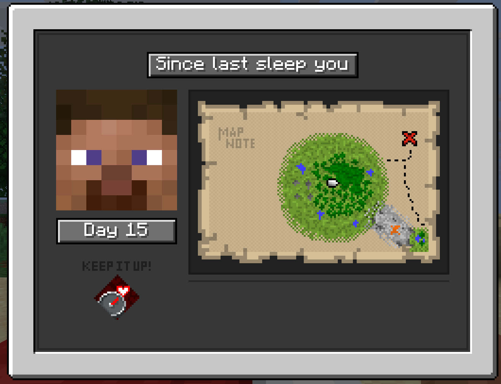
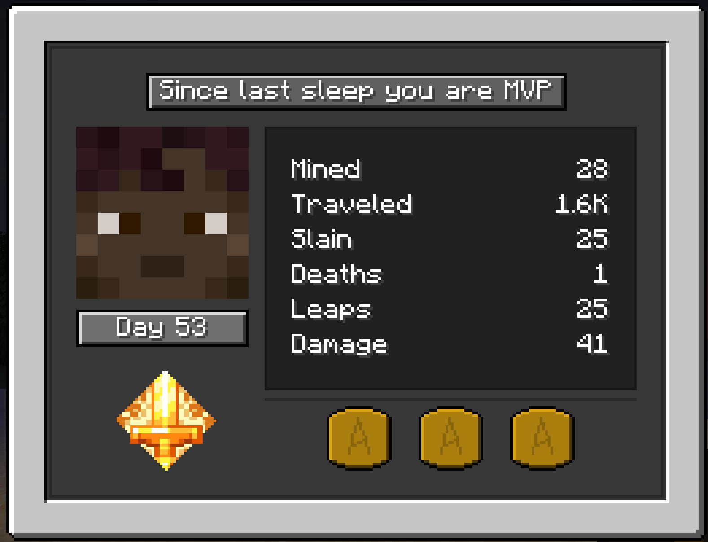
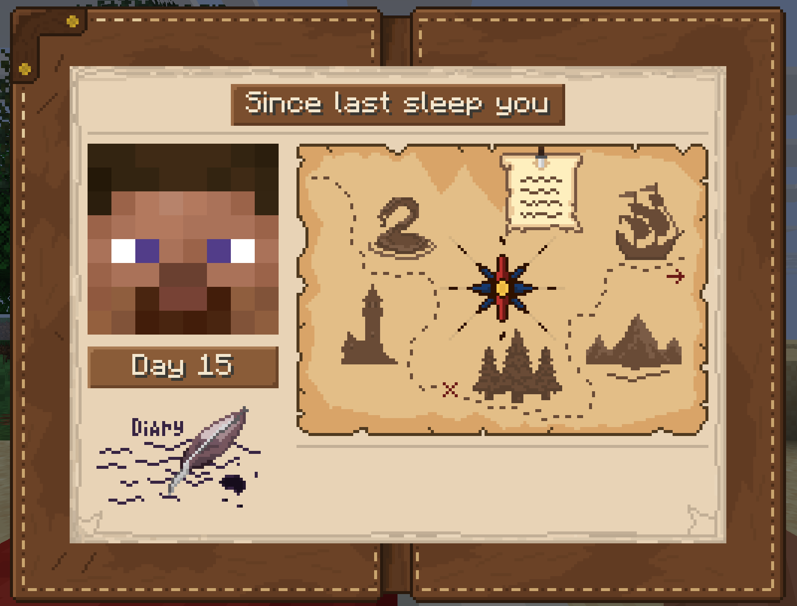
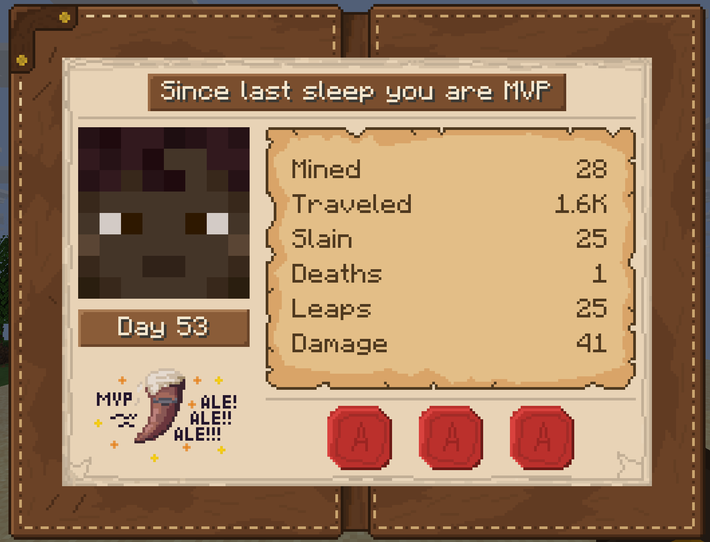
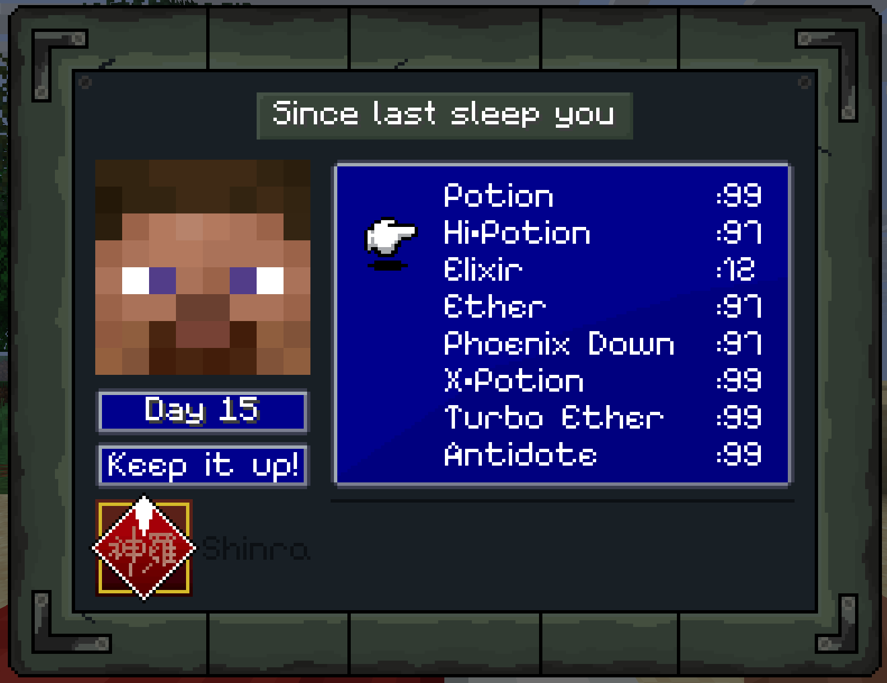
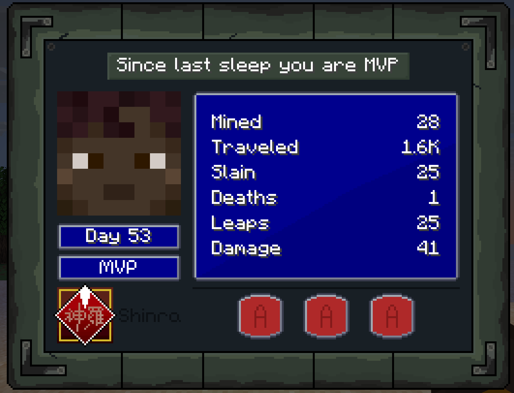
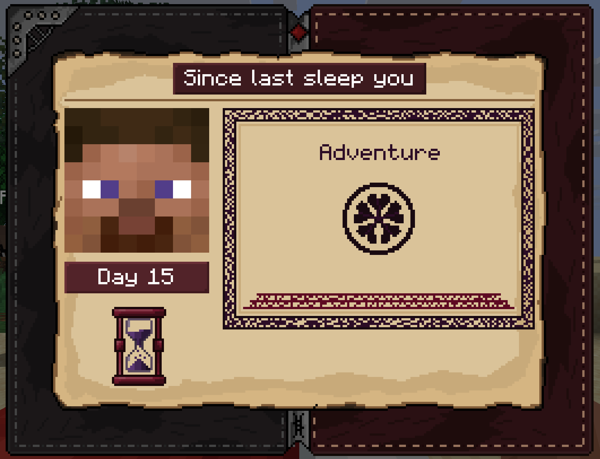
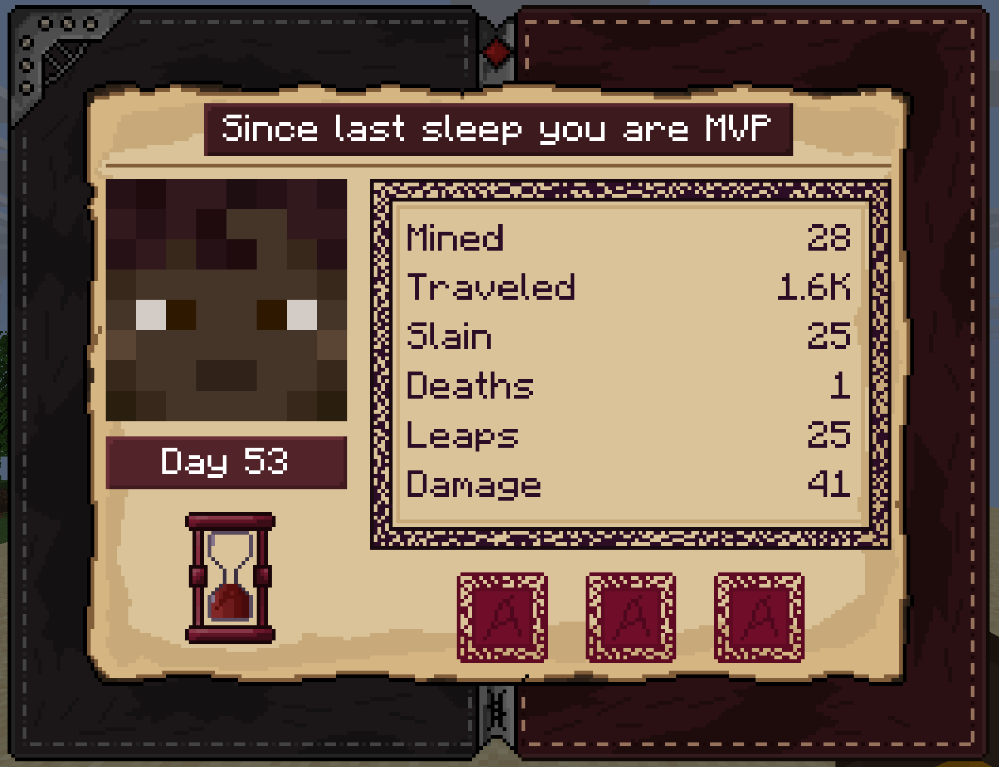

import Tabs from '@theme/Tabs';
import TabItem from '@theme/TabItem';
import Admonition from '@theme/Admonition';

# Summary screen

After waking up, every player who slept receives a diary of everything they did since their last sleep. The screen has four themes and two styles: **Picture** and **Table**.

---

## The card

The summary shows **one card per player**. In single player that is just your own card, on a server every player who slept that night gets one.

| Part of the card | What it shows |
|---|---|
| Headline | Whose results these are: `Since last sleep you`, `Since last sleep you are MVP`, `Steve's results` or `Steve became MVP` |
| Player head | The player's skin. With [MCA Reborn](#integrations) it can show the MCA skin instead |
| Day badge | The current day of the world, for example `Day 42` |
| Stats panel | All six statistics. In the Picture style hover over it, in the Table style they are listed right on the panel |
| Achievements | Up to three achievement tokens earned this night |

**Stats panel.** How the statistics are shown depends on the [summary style](#summary-style). What each number means is on the [player statistics](./player-statistics) page.

**Achievements.** Each achievement is a small token under the stats panel. Hover over a token to see its name and description. A card shows up to three of them. Custom achievements work the same way, see [custom achievements](./custom-achievements).

**MVP.** The MVP card has its own frame, so it stands out from the others. See [player statistics](./player-statistics) for how the MVP is chosen.

---

## Flipping through cards

When more than one player slept, arrow buttons appear under the card.

| Action | Mouse | Keyboard |
|---|---|---|
| Previous card | Left arrow button | Your **Strafe Left** key, `A` by default |
| Next card | Right arrow button | Your **Strafe Right** key, `D` by default |
| Close | | Your **Inventory** key, `E` by default, or `Esc` |

The keys follow your own controls, so if you moved strafing to other keys, those keys flip the cards.

The cards are sorted: the MVP comes first, then your own card, then everyone else.

<Admonition type="note">
    The summary does not pause the game, even in single player.
</Admonition>

---

## Summary style

The stats panel has two styles. Switch between them with **Summary style** in the config screen, or set `summaryStyle` in the file.

<Tabs groupId="summary-style">
    <TabItem value="picture" label="Picture" default>

        The default. The panel shows an illustration, and hovering over it opens a large tooltip with the results as short lines:

        ```
        Mined 120 blocks
        Walked 2.4K blocks
        Killed 14 mobs
        Died 1 time
        Jumped 306 times
        Dealt 95 damage
        ```

        The words follow the game language, including the right plural forms.

        ```json
        "summaryStyle": "picture"
        ```

    </TabItem>
    <TabItem value="table" label="Table">

        Every statistic is listed right on the panel, no hovering needed. The name is on the left, the number on the right:

        ```
        Mined         120
        Traveled     2.4K
        Slain          14
        Deaths          1
        Leaps         306
        Damage         95
        ```

        When the summary opens, the numbers count up from zero to their real values. Flipping to another card starts the count again.

        ```json
        "summaryStyle": "table"
        ```

    </TabItem>
</Tabs>

Achievements, the head, the day badge and everything else on the card look the same in both styles. Pictures of both styles for every theme are in the [themes](#themes) section below.

<Admonition type="note">
    Like the summary size, this is a personal setting. It is read from your own config file even on a server, so every player can pick the style they like. On a server, open the config screen and use the **Personal** section.
</Admonition>

<Admonition type="tip" title="For modpacks and servers with their own pack">
    The style and the size are taken from the player's own `config/midnightthoughts.json`. To make the table style the default in your pack, ship that file with `"summaryStyle": "table"`. Players can still switch it for themselves.
</Admonition>

---

## Summary size

By default the summary is as large as the screen allows. If it looks too big next to the rest of the interface, change **Summary size** in the config screen, in the **Interface** section, or set `summaryScale` in the file:

| Value | In the file | Size |
|---|---|---|
| Auto | `0` | As large as fits on the screen. This is the default |
| 1x | `1` | One pixel of the texture is one pixel of the interface, like vanilla screens. The size follows the game's **GUI Scale** option |
| 2x, 3x, 4x | `2`, `3`, `4` | A fixed size |

The summary never grows past the screen. If the chosen size does not fit, it uses the largest size that does, so on a small screen 3x and 4x can look the same as Auto.

Every size is a whole multiple, so the textures and the text always stay sharp.

<Admonition type="note">
    This is a personal setting. It is read from your own config file even on a server, so every player can pick the size that suits their monitor. On a server, open the config screen and use the **Personal** section.
</Admonition>

---

## Themes

<Tabs>
    <TabItem value="vanilla" label="Vanilla" default>

        <Tabs groupId="summary-style">
            <TabItem value="picture" label="Picture" default>

                

            </TabItem>
            <TabItem value="table" label="Table">

                

            </TabItem>
        </Tabs>

        The Vanilla theme is designed in a Minecraft style to blend in with the overall vanilla theme. It's compatible with QOL modpacks.

    </TabItem>
    <TabItem value="classic" label="Classic">

        <Tabs groupId="summary-style">
            <TabItem value="picture" label="Picture" default>

                

            </TabItem>
            <TabItem value="table" label="Table">

                

            </TabItem>
        </Tabs>

        The Classic theme is the default. It features a medieval style and is suitable for classic RPG modpacks.

    </TabItem>
    <TabItem value="tech" label="Tech">

        <Tabs groupId="summary-style">
            <TabItem value="picture" label="Picture" default>

                

            </TabItem>
            <TabItem value="table" label="Table">

                

            </TabItem>
        </Tabs>

        The Tech theme is more specific. It's inspired by Final Fantasy 7 and is suitable for more technical-biological modpacks.

    </TabItem>
    <TabItem value="magic" label="Magic">

        <Tabs groupId="summary-style">
            <TabItem value="picture" label="Picture" default>

                

            </TabItem>
            <TabItem value="table" label="Table">

                

            </TabItem>
        </Tabs>

        The Magic theme has a gothic style inspired by Black Clover. Suitable for magic-based modpacks.

    </TabItem>
</Tabs>

---

## Switching themes

The theme is picked in the config screen, in the **Interface** section, or in the config file:

```json
"theme": "classic"
```

Available options: `classic`, `vanilla`, `tech`, `magic`. The theme applies to the summary screen and to the sleeping players HUD.

On a server, the theme is determined by the server itself, so every player sees the same one.

<Admonition type="info" title="Changed in 1.6">
    The gear button on the summary screen was removed, and with it the personal theme and the `hideThemeSwitchButton` option. The theme now lives in the config screen together with the other settings.
</Admonition>

---

## Integrations

<Tabs>
    <TabItem value="mca" label="MCA Reborn" default>

        If [MCA Reborn](https://modrinth.com/mod/minecraft-comes-alive-reborn) is installed and a player uses the MCA skin option, the card shows their MCA head instead of the vanilla one. Players with a regular skin keep their normal head.

    </TabItem>
    <TabItem value="seasons" label="Serene Seasons">

        If [Serene Seasons](https://modrinth.com/mod/serene-seasons) is installed, hover over the day badge to see the Serene Seasons calendar: the current season and the day within it, for example `Mid Autumn` and `Day 3/8`. In tropical biomes it shows the tropical season instead.

    </TabItem>
</Tabs>

<Admonition type="note">
    Both integrations are optional and only run on the client. Without these mods the card simply shows the vanilla head and a day badge without a tooltip.
</Admonition>

---

## Config

| Parameter | Default | Description |
|---|---|---|
| `theme` | `"classic"` | Theme for all players |
| `enableDailySummaryScreen` | `true` | Set to `false` to completely disable the summary screen |
| `summaryStyle` | `"picture"` | `picture` or `table`. Personal setting, see [summary style](#summary-style) |
| `summaryScale` | `0` | `0` is Auto, `1` to `4` is a fixed size. Personal setting, see [summary size](#summary-size) |

<Admonition type="note">
    An invalid theme name in the config is not an error. It resets to `classic` and the correction is written to the server log.
</Admonition>

---

## When the summary arrives

The summary follows the vanilla sleep rules. It is shown to players who **actually slept** through the night, at the moment their night is over.

### In the Overworld

The summary is sent once morning comes in the Overworld and **every player who slept has left the bed**. With vanilla sleep this is the moment everyone wakes up. Mods that let the night pass gradually, such as **Better Days** or **Seamless Sleep**, keep players in bed while time speeds up, so the summary waits until they get up instead of appearing while someone is still asleep.

Morning here is the vanilla morning, the same moment the game itself uses to wake players up. So the summary always arrives together with everything else the game and other mods do in the morning.

<Admonition type="note" title="Thunderstorms">
    The game treats a thunderstorm as night. If a storm was going when you woke up, the summary arrives a little later, once the storm calms down. With vanilla settings this takes a couple of seconds.
</Admonition>

<Admonition type="note" title="Daylight cycle off">
    If the daylight cycle game rule is off, the time never moves and morning never comes. The summary arrives once the time is set to day.
</Admonition>

### Sleeping during a thunderstorm

During a thunderstorm you can lie down even in the middle of the day, the game counts it as night.

| What happens | Summary |
|---|---|
| Enough players sleep and the storm is skipped | Yes, as soon as everyone is up. Time jumps to the next morning and the storm clears |
| No skip, you stay in bed until the storm ends on its own | Yes, when the storm ends |
| You get up during the storm | No |

### Getting up too early

You get no summary and no Well Rested if your sleep did not last until morning:

- you got out of bed on your own
- your bed was broken while you slept
- you took damage, died or were teleported while in bed

If you lie down again and sleep through the rest of the night, you get the summary as usual. A player who tried to sleep and was refused because of low [comfort](./comfort-system) does not count as having slept.

### Other dimensions

Some mods add dimensions where you can sleep. Midnight Thoughts supports them, and the summary depends on how time works there.

| Dimension | When you get the summary |
|---|---|
| **Frozen time**, the sun never moves, for example the Twilight Forest | Right after the dimension wakes you up. You can sleep there at any time, and you never wait for the Overworld morning |
| **Time shared with the Overworld** | Together with the Overworld morning, in the same summary as the Overworld sleepers. If your dimension wakes you up earlier, you get your own summary right away |

A player sleeping in a dimension with frozen time never delays the summary for players in the Overworld. Players who wake up there together share one summary.

<Admonition type="info">
    Whether you can sleep in a dimension is decided by the mod that adds it. On 26.1.2 the Twilight Forest does not allow sleeping, its beds only set the spawn point.
</Admonition>

### MVP

The MVP is picked among the players who woke up together. If players in the Overworld and in another dimension wake up separately, each group gets its own summary and its own MVP. A summary with a single player has no MVP.

### Sleep mods

A sleep mod works with Midnight Thoughts if it wakes players at the vanilla morning or later. **Better Days** and **Seamless Sleep** do. See [compatibility](./compatibility#sleep-mods).

<Admonition type="tip">
    This ties into the vanilla `playerSleepingPercentage` gamerule. Details on the [for servers](./for-servers) page.
</Admonition>
