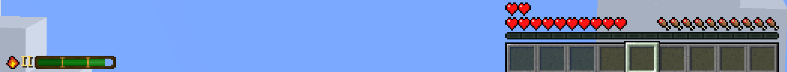
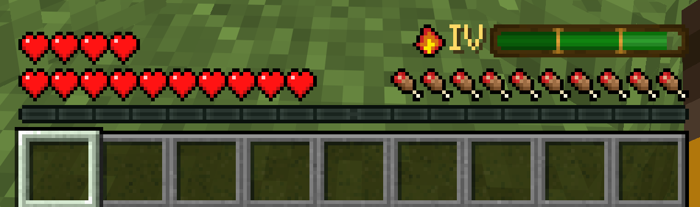

import Tabs from '@theme/Tabs';
import TabItem from '@theme/TabItem';
import Admonition from '@theme/Admonition';

# Well Rested

<Admonition type="info">
    By default Well Rested provides bonuses to speed, strength, attack speed and block mining speed, increases the player's HP, and also adds gradual health regeneration. The extra health and regeneration don't diminish over time, unlike the other buffs. All of this is fully configurable, including attributes and potion effects from other mods.
</Admonition>

The Well Rested level depends on the [comfort](./comfort-system) of the sleeping area. Comfort is measured around the bed at the moment the player lies down, so walking away from the bedroom after waking up does not change the result.

After waking up, the player receives the **Rested** effect. The effect has **up to 5 levels**. Higher levels increase **strength** and **duration**.

Each level progresses through **three phases**, gradually weakening over time. Every phase lasts one third of the total duration.

| Phase | Strength |
|---|---|
| Phase 1 | Strongest |
| Phase 2 | Medium |
| Phase 3 | Weakest |

<Admonition type="tip">
    With the default values higher Rested levels are always stronger overall. For example, Phase 3 of Level 5 is still stronger than Phase 1 of Level 1.
</Admonition>

If a player goes to bed with the Well Rested buff, they will only receive a new buff upon waking if it is stronger than the buff they already have. For example, if a player currently has Well Rested at level 4, sleeping in a location that only provides Well Rested at level 1 will keep their level 4 buff. However, if the current buff is stronger but is about to expire, the player will receive a new one, even if it is weaker.

---

## HUD

While the effect is active, a small bar shows the remaining time, and a numeral shows the level.

You can hide it completely in the config screen (**Interface** section) or in the file:

```json
"ui": {
  "hideWellRestedHud": true
}
```

The HUD has three positions, chosen with `wellRestedHudPosition` inside `ui`, or with the **Well Rested HUD position** button in the config screen:

<Tabs>
    <TabItem value="left" label="left" default>

        Bottom left corner. This is the default.

        ```json
        "wellRestedHudPosition": "left"
        ```

        

    </TabItem>
    <TabItem value="bar" label="bar">

        Above the hunger bar, aligned with the right edge of the vanilla bars. Air bubbles move up to make room.

        ```json
        "wellRestedHudPosition": "bar"
        ```

        

    </TabItem>
    <TabItem value="right" label="right">

        Bottom right corner.

        ```json
        "wellRestedHudPosition": "right"
        ```

        

    </TabItem>
</Tabs>

<Admonition type="note">
    An unknown value falls back to `left`, and the corrected value is written back to the config file.
</Admonition>

<Admonition type="info" title="Changed in 1.6">
    The HUD no longer blinks during the last seconds of the effect. It stays steady until the effect ends.
</Admonition>

---

## Config

The whole system can be switched off with a single flag:

```json
"wellRested": {
  "enabled": true
}
```

With `enabled: false` no effect is ever granted. Sleeping still shows the overlay and the summary, players just wake up without buffs.

<Admonition type="warning">
    Well Rested levels are edited **only in the config file**. They are not part of the in-game config screen.
</Admonition>

Every level has four fields:

| Field | Description |
|---|---|
| `durationMinutes` | Total duration of the effect at this level, from 1 to 1440 minutes |
| `regenBonus` | Health regeneration, see [Regeneration](#regeneration) below |
| `attributes` | A list of attribute bonuses, each with its own value per phase |
| `effects` | A list of potion effects, each with its own level per phase |

---

## Attributes

Each entry in `attributes` changes one attribute of the player:

```json
{
  "id": "minecraft:movement_speed",
  "operation": "add_multiplied_base",
  "phase1": 0.25,
  "phase2": 0.15,
  "phase3": 0.08
}
```

| Field | Description |
|---|---|
| `id` | Attribute id. Any attribute registered in the game works, including attributes from other mods |
| `operation` | How the value is applied, see the table below |
| `phase1`, `phase2`, `phase3` | The value for each phase. Use the same number in all three for a bonus that does not weaken |

| Operation | What it does | Example |
|---|---|---|
| `add_value` | Adds the number directly to the attribute | `1.5` on `attack_damage` adds 1.5 damage to every hit |
| `add_multiplied_base` | Adds a share of the base value | `0.25` on `movement_speed` makes the player 25% faster |
| `add_multiplied_total` | Multiplies the final value, after all other modifiers | `0.1` makes the final value 10% bigger |

<Admonition type="note">
    The 1.20.1 operation names `addition`, `multiply_base` and `multiply_total` are accepted too, on every version. They mean the same as the three above.
</Admonition>

All bonuses stack with potions and with modifiers from other mods. When a phase changes, the values are swapped in place. When the effect ends, every bonus the mod added is removed. When the effect is granted, the player's health is filled up to the new maximum.

### Default attributes

<Tabs>
    <TabItem value="1211" label="1.21.1+" default>

        | Attribute | Operation | What it gives |
        |---|---|---|
        | `minecraft:movement_speed` | `add_multiplied_base` | Faster walking |
        | `minecraft:attack_damage` | `add_value` | Flat damage on every hit, like the Strength potion |
        | `minecraft:block_break_speed` | `add_multiplied_base` | Faster mining |
        | `minecraft:attack_speed` | `add_multiplied_base` | Faster weapon cooldown |
        | `minecraft:max_health` | `add_value` | Extra health, `2.0` is one heart. Same value in every phase |

    </TabItem>
    <TabItem value="1201" label="1.20.1">

        | Attribute | Operation | What it gives |
        |---|---|---|
        | `minecraft:generic.movement_speed` | `add_multiplied_base` | Faster walking |
        | `minecraft:generic.attack_damage` | `add_value` | Flat damage on every hit, like the Strength potion |
        | `minecraft:generic.attack_speed` | `add_multiplied_base` | Faster weapon cooldown |
        | `minecraft:generic.max_health` | `add_value` | Extra health, `2.0` is one heart. Same value in every phase |

        <Admonition type="warning">
            On 1.20.1 attribute ids use the `generic.` prefix, and there is no mining speed attribute at all. Minecraft only added `block_break_speed` in 1.21. Ids written in the 1.21 style, such as `minecraft:movement_speed`, are skipped on 1.20.1 with a warning in the log.
        </Admonition>

    </TabItem>
</Tabs>

### Default values

<Tabs>
    <TabItem value="level5" label="Level 5" default>

        | Attribute | Phase 1 | Phase 2 | Phase 3 |
        |---|---|---|---|
        | `movement_speed` | 0.25 | 0.15 | 0.08 |
        | `attack_damage` | 1.5 | 1.0 | 0.5 |
        | `block_break_speed` | 0.25 | 0.14 | 0.07 |
        | `attack_speed` | 0.07 | 0.04 | 0.02 |
        | `max_health` | 10.0 | 10.0 | 10.0 |

        Duration 15 minutes, `regenBonus` 0.05.

    </TabItem>
    <TabItem value="level4" label="Level 4">

        | Attribute | Phase 1 | Phase 2 | Phase 3 |
        |---|---|---|---|
        | `movement_speed` | 0.2 | 0.12 | 0.06 |
        | `attack_damage` | 1.0 | 0.75 | 0.5 |
        | `block_break_speed` | 0.2 | 0.11 | 0.06 |
        | `attack_speed` | 0.06 | 0.03 | 0.02 |
        | `max_health` | 8.0 | 8.0 | 8.0 |

        Duration 10 minutes, `regenBonus` 0.04.

    </TabItem>
    <TabItem value="level3" label="Level 3">

        | Attribute | Phase 1 | Phase 2 | Phase 3 |
        |---|---|---|---|
        | `movement_speed` | 0.16 | 0.09 | 0.04 |
        | `attack_damage` | 0.75 | 0.5 | 0.25 |
        | `block_break_speed` | 0.15 | 0.08 | 0.04 |
        | `attack_speed` | 0.05 | 0.03 | 0.01 |
        | `max_health` | 6.0 | 6.0 | 6.0 |

        Duration 7 minutes, `regenBonus` 0.03.

    </TabItem>
    <TabItem value="level2" label="Level 2">

        | Attribute | Phase 1 | Phase 2 | Phase 3 |
        |---|---|---|---|
        | `movement_speed` | 0.12 | 0.06 | 0.03 |
        | `attack_damage` | 0.5 | 0.25 | 0.25 |
        | `block_break_speed` | 0.11 | 0.06 | 0.03 |
        | `attack_speed` | 0.04 | 0.02 | 0.01 |
        | `max_health` | 4.0 | 4.0 | 4.0 |

        Duration 5 minutes, `regenBonus` 0.02.

    </TabItem>
    <TabItem value="level1" label="Level 1">

        | Attribute | Phase 1 | Phase 2 | Phase 3 |
        |---|---|---|---|
        | `movement_speed` | 0.08 | 0.04 | 0.02 |
        | `attack_damage` | 0.25 | 0.25 | 0.25 |
        | `block_break_speed` | 0.07 | 0.04 | 0.02 |
        | `attack_speed` | 0.02 | 0.01 | 0.01 |
        | `max_health` | 2.0 | 2.0 | 2.0 |

        Duration 3 minutes, `regenBonus` 0.01.

    </TabItem>
</Tabs>

The values are the same on every version. On 1.20.1 the `block_break_speed` row does not exist. The full JSON is on the [config](./config) page.

---

## Effects

Each entry in `effects` gives the player a potion effect while Well Rested is active:

```json
{
  "id": "minecraft:night_vision",
  "phase1": 0,
  "phase2": 0,
  "phase3": -1
}
```

| Field | Description |
|---|---|
| `id` | Effect id. Any effect registered in the game works, including effects from other mods |
| `phase1`, `phase2`, `phase3` | Effect level for each phase. `0` is level I, `1` is level II and so on, up to `255`. `-1` means no effect in that phase |

The example above gives Night Vision during the first two phases and removes it for the last one.

Effects given by Well Rested are shown with their icon, but without particles. They are refreshed with the new level when the phase changes, and removed together with Well Rested.

By default every level has an empty list, `"effects": []`.

---

## Customizing

A few examples of what the lists make possible.

<Tabs>
    <TabItem value="add" label="Add a bonus" default>

        Add armor to level 5 by adding one entry to its `attributes` list:

        ```json
        {
          "id": "minecraft:armor",
          "operation": "add_value",
          "phase1": 4.0,
          "phase2": 2.0,
          "phase3": 1.0
        }
        ```

        On 1.20.1 the id is `minecraft:generic.armor`.

    </TabItem>
    <TabItem value="mod" label="Attribute from another mod">

        Any mod that registers its own attributes can be used the same way. Use the id the mod registers:

        ```json
        {
          "id": "examplemod:mana_regen",
          "operation": "add_multiplied_base",
          "phase1": 0.3,
          "phase2": 0.2,
          "phase3": 0.1
        }
        ```

        If the mod is not installed, the entry is simply skipped and a warning is written to the log once.

    </TabItem>
    <TabItem value="remove" label="Remove a bonus">

        Delete the entry from the list. To give a level no attribute bonuses at all, leave an empty list:

        ```json
        "attributes": []
        ```

        <Admonition type="warning">
            Do not delete the `attributes` key itself. A level without the key is treated as missing and gets the default list back.
        </Admonition>

    </TabItem>
</Tabs>

<Admonition type="tip">
    After editing the file, run `/midnightthoughts reload config`. Every new effect uses the new values right away. An effect that is already running picks up new attributes and effects at its next phase change, and new regeneration immediately.
</Admonition>

---

## Regeneration

`regenBonus` restores the player's health every 5 seconds. The amount of healing is calculated as a percentage of the player's maximum health:

heal = maxHealth × regenBonus × 0.5

For example, with 20 HP (10 hearts) and `regenBonus = 0.05`, it restores 0.5 HP every 5 seconds.

<Admonition type="note">
    Regeneration does not depend on the phase. By default the extra health doesn't either, because `max_health` has the same value in all three phases.
</Admonition>

---

## Granting it manually

Operators can hand out or remove the effect without anyone sleeping:

```
/midnightthoughts wellrested grant @a 5
/midnightthoughts wellrested clear @a
```

Useful for event servers, testing a config change, or rewarding players after a boss fight. Full syntax on the [commands](./commands) page.

<Admonition type="warning">
    `grant` refuses to run while `"enabled": false` and says so, rather than pretending to work.
</Admonition>

Mod and modpack developers can do the same from code. See [KubeJS](./kubejs) and the [Java API](./java-api).
